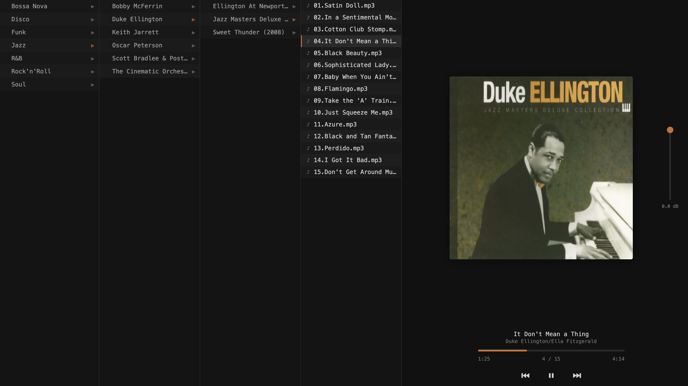

<p align="center">
  
</p>

<h1 align="center">love</h1>

<p align="center">
  Self-hosted web music player that mirrors the folder-browsing experience of a hardware DAP.
  <br>
  Browse your folder tree and play.
</p>



## Why

Every music app tries to be smart — indexing, playlisting, recommending. But on a hardware player like the FiiO X1 II or xDuo X34001, the experience is simpler: you organized your folders by genre, artist, album, and you just browse that tree. That's the whole interaction model, and it works because the organization is already yours.

No existing self-hosted player preserves this. Love does.

## Features

- **Miller column navigation** — Finder-style column view of your music folder tree
- **Keyboard-first** — vim keys (hjkl), arrows, space for play/pause, `/` for search
- **Quick lists** — collect tracks in ten colored slots. Each list stays in this browser until you clear it
- **Automatic library refresh** — folder browsing and search follow added, renamed, and deleted music without restarting; open tabs update while playback continues
- **Fuzzy search** — search the full path to find tracks across your library
- **Cover art** — extracted from embedded ID3/Vorbis tags
- **FLAC support** — transcoded to Opus on the fly via ffmpeg, cached for instant replay
- **Download selected track** — save the highlighted track in its original format and filename, including untranscoded FLAC
- **MediaSession** — macOS media keys (play/pause/prev/next) work out of the box
- **Persistent state** — reload the page and resume where you left off
- **dB volume** — logarithmic fader with Ableton-style curve

## Quick start

```
git clone https://github.com/amenocturne/love.git
cd love
just setup
just run ~/Music
```

Open `http://localhost:3000`.

Requires: Rust, Bun, ffmpeg.

## Docker

```yaml
services:
  love:
    build: .
    ports:
      - "3000:3000"
    volumes:
      - /path/to/music:/music:ro
```

```
docker compose up -d
```

Library changes are checked every 5 seconds. Set `LIBRARY_REFRESH_SECONDS` to a positive integer to change the server scan interval. Visible browser tabs check for new snapshots every 5 seconds and on returning to the tab. Failed scans retain the previous complete library and retry automatically.

## Keyboard shortcuts

| Key | Action |
|-----|--------|
| `j` / `↓` | Move down |
| `k` / `↑` | Move up |
| `l` / `→` / `Enter` | Open a folder or list, or play the selected track |
| `h` / `←` | Go to the parent column |
| `Tab` | Switch between Folders and Lists while browsing |
| `1`–`0` | Add or remove the selected track in the corresponding list |
| `x` | Ask to clear the selected numbered list |
| `Space` | Play / pause |
| `/` | Open search |
| `Esc` | Close search / double-press to stop |

Folders and Lists each keep their browsing position. Playback follows the folder or list you started it from, even when you switch views. To reuse a slot, press `x` on its row or click **×** beside its number, then confirm.

## Tech

- **Backend:** Rust (axum, lofty, tokio)
- **Frontend:** Vanilla TypeScript, bundled by Bun
- **Transcode:** ffmpeg subprocess for FLAC → Opus
- **No database** — filesystem is the source of truth
